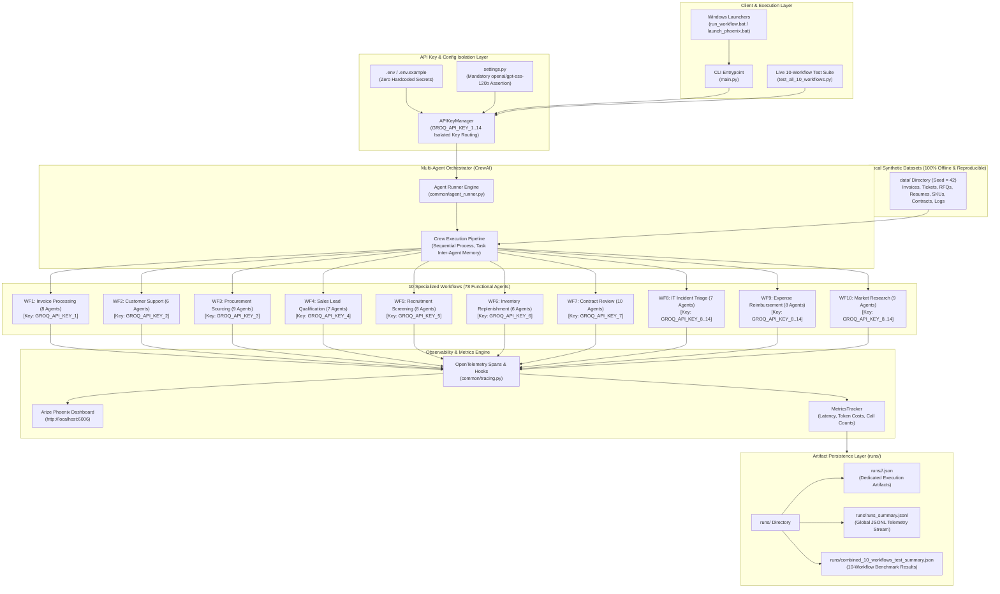
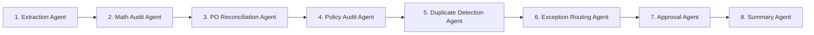
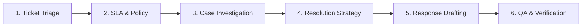
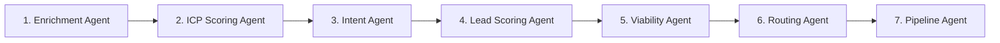

# Target-MAS: Enterprise Multi-Agent Systems Dataset & Execution Benchmark

[](https://www.python.org/downloads/)
[](https://crewai.com)
[](https://groq.com)
[](https://phoenix.arize.com/)
[](https://opensource.org/licenses/MIT)

A production-grade benchmark and evaluation dataset for **Multi-Agent Systems (MAS)**. This repository hosts **10 complete enterprise workflows** powered by **78 specialized autonomous agents**, orchestrated via **CrewAI**, powered exclusively by Groq's `openai/gpt-oss-120b`, and monitored through **Arize Phoenix** OpenTelemetry tracing.

---

## Table of Contents

- [1. System Architecture](#1-system-architecture)
- [2. Architectural Principles & Invariants](#2-architectural-principles--invariants)
- [3. The 10 Multi-Agent Workflows (78 Agents)](#3-the-10-multi-agent-workflows-78-agents)
  - [Workflow 1: Invoice Processing & Accounts Payable](#workflow-1-invoice-processing--accounts-payable-8-agents)
  - [Workflow 2: Customer Support Ticket Resolution](#workflow-2-customer-support-ticket-resolution-6-agents)
  - [Workflow 3: Procurement & Supplier Selection](#workflow-3-procurement--supplier-selection-9-agents)
  - [Workflow 4: Sales Lead Qualification](#workflow-4-sales-lead-qualification-7-agents)
  - [Workflow 5: Recruitment & Resume Screening](#workflow-5-recruitment--resume-screening-8-agents)
  - [Workflow 6: Inventory Replenishment Planning](#workflow-6-inventory-replenishment-planning-6-agents)
  - [Workflow 7: Contract Review & Compliance](#workflow-7-contract-review--compliance-10-agents)
  - [Workflow 8: IT Incident Triage & Remediation](#workflow-8-it-incident-triage--remediation-7-agents)
  - [Workflow 9: Employee Expense Reimbursement](#workflow-9-employee-expense-reimbursement-8-agents)
  - [Workflow 10: Market & Competitor Research](#workflow-10-market--competitor-research-9-agents)
- [4. Repository Structure](#4-repository-structure)
- [5. Dataset Schema & Execution Artifacts (`runs/`)](#5-dataset-schema--execution-artifacts-runs)
- [6. Setup & Installation](#6-setup--installation)
- [7. CLI & Workflow Execution](#7-cli--workflow-execution)
- [8. Tracing & Observability with Arize Phoenix](#8-tracing--observability-with-arize-phoenix)
- [9. Testing & Verification](#9-testing--verification)

---

## 1. System Architecture

The following diagram illustrates the complete end-to-end architecture: from CLI/batch entrypoints, through deterministic API key routing and isolated Groq execution, down to structured workflow persistence and telemetry observability.



---

## 2. Architectural Principles & Invariants

1. **Mandatory Model Enforcement:**
   Every agent in this repository strictly runs on `openai/gpt-oss-120b` served through the Groq API. The model string is validated at initialization and cannot be downgraded.
2. **Dedicated API Key Isolation:**
   Workflows 1 through 7 each bind to an independent Groq API key (`GROQ_API_KEY_1` through `GROQ_API_KEY_7`), preventing cross-workflow rate limiting and quota contention. Workflows 8 through 10 rotate through keys `GROQ_API_KEY_8` through `GROQ_API_KEY_14`. Raw secret keys are masked in logs (`gsk_...abcd`).
3. **Deterministic First Design:**
   Pure arithmetic, financial additions, 3-way reconciliation, SLA severity lookups, EOQ/safety-stock formulas, and compliance threshold validations are computed in deterministic Python before passing structured context to LLM agents.
4. **Complete Local Reproducibility:**
   All datasets under `data/` are generated locally via `generate_dummy_data.py` (fixed random seed = `42`). Zero reliance on third-party scrapers or external networks.
5. **No Cloud Observability Lock-in:**
   Arize Phoenix runs locally on `http://localhost:6006` with zero cloud credentials needed.

---

## 3. The 10 Multi-Agent Workflows (78 Agents)

| # | Workflow Domain | CLI Alias | Key Bound | Agents | Primary Objective |
| :-: | :--- | :---: | :--- | :---: | :--- |
| **1** | **Invoice Processing & AP** | `invoice` | `GROQ_API_KEY_1` | **8** | Extract invoice line items, run math checks, reconcile against POs, audit AP policies, detect duplicate billings, and adjudicate approval. |
| **2** | **Customer Support Resolution** | `support` | `GROQ_API_KEY_2` | **6** | Ingest support tickets, retrieve customer tier and SLAs, look up troubleshooting SOPs, analyze sentiment, and draft verified solutions. |
| **3** | **Procurement & Sourcing** | `procurement` | `GROQ_API_KEY_3` | **9** | Normalize vendor bids, verify lead times, assess supplier financial/operational risk, rank quotes via weighted MCDA, and generate award contracts. |
| **4** | **Sales Lead Qualification** | `sales` | `GROQ_API_KEY_4` | **7** | Enrich inbound company firmographics, score ICP alignment (0–100), analyze buyer intent signals, determine BANT viability, and route to sales pipelines. |
| **5** | **Recruitment Screening** | `recruitment` | `GROQ_API_KEY_5` | **8** | Parse candidate resumes, extract qualification evidence IDs, evaluate career progression, flag gaps, and synthesize recruiter interview guides. |
| **6** | **Inventory Replenishment** | `inventory` | `GROQ_API_KEY_6` | **6** | Audit warehouse stock levels, compute reorder points and safety stock formulas, project lead-time demand, and emit supplier replenishment POs. |
| **7** | **Contract Review & Compliance** | `contract` | `GROQ_API_KEY_7` | **10** | Extract contract clauses, map against corporate policy baselines, detect deviation risks, check cross-clause consistency, and compile legal review audits. |
| **8** | **IT Incident Triage** | `incident` | `GROQ_API_KEY_8..14` | **7** | Normalize telemetry alerts, classify failure domains, retrieve runbooks, correlate logs, compute SLA severity, and draft remediation runbooks. |
| **9** | **Expense Reimbursement** | `expense` | `GROQ_API_KEY_8..14` | **8** | Parse expense receipts, assign GL accounts, run arithmetic checks, audit corporate travel & expense policies, detect duplicate receipts, and approve payouts. |
| **10** | **Market & Competitor Research** | `market` | `GROQ_API_KEY_8..14` | **9** | Deconstruct research questions, profile competitors, analyze pricing structures, triangulate customer sentiment, and construct comparative feature matrices. |

---

### Workflow 1: Invoice Processing & Accounts Payable (8 Agents)
*Key: `GROQ_API_KEY_1` | Directory: `Agents/invoice_processing/`*



1. **Invoice Extraction Agent:** Extracts vendor details, dates, currencies, line items, and totals from structured raw payloads.
2. **Mathematical Audit Agent:** Validates line item arithmetic `(quantity * unit_price == line_total)` and ensures `subtotal + tax - discount == total`.
3. **PO Reconciliation Agent:** Performs 3-way matching between invoice, PO records, and receiving slips.
4. **Policy Compliance Agent:** Audits vendor terms against corporate payment schedules and threshold limits.
5. **Duplicate Billing Detection Agent:** Hashes invoice signatures to identify overlapping or recurring billings.
6. **Exception Routing Agent:** Triages invoice discrepancies (unmatched PO, price variance, missing tax ID) into appropriate escalation tiers.
7. **Approval Recommendation Agent:** Emits a final programmatic decision (`APPROVE`, `FLAG_FOR_REVIEW`, or `REJECT`).
8. **Summary & Audit Trail Agent:** Serializes the complete audit trail and outputs final ledger artifacts.

---

### Workflow 2: Customer Support Ticket Resolution (6 Agents)
*Key: `GROQ_API_KEY_2` | Directory: `Agents/customer_support/`*



1. **Ticket Triage Agent:** Classifies tickets into categories (Billing, Access, Technical, Account) and assigns urgency.
2. **SLA & Policy Retrieval Agent:** Matches customer tier (Free, Pro, Enterprise) to SLA response windows and entitlement policies.
3. **Case Investigation Agent:** Analyzes error codes, logs, and account states against knowledge base articles.
4. **Resolution Strategy Agent:** Formulates concrete step-by-step resolution pathways or determines refund eligibility.
5. **Response Drafting Agent:** Writes empathetic, professional customer responses incorporating resolution instructions.
6. **QA & Verification Agent:** Checks drafted responses for policy compliance, clarity, tone, and accuracy before dispatch.

---

### Workflow 3: Procurement & Supplier Selection (9 Agents)
*Key: `GROQ_API_KEY_3` | Directory: `Agents/procurement_supplier_selection/`*

```mermaid
flowchart LR
    C1["1. Bid Normalizer"] --> C2["2. Profile Auditor"]
    C2 --> C3["3. Schedule Logistics"]
    C3 --> C4["4. Risk Assessor"]
    C4 --> C5["5. Contract Review"]
    C5 --> C6["6. Cost Ranker"]
    C6 --> C7["7. MCDA Evaluator"]
    C7 --> C8["8. Sourcing Recommender"]
    C8 --> C9["9. Award Summary"]
```



1. **Bid Normalization Agent:** Standardizes disparate vendor quotations, currencies, freight terms, and volume discounts into comparable units.
2. **Vendor Profile Auditor:** Audits supplier certifications, track record, financial standing, and capacity.
3. **Schedule & Logistics Agent:** Evaluates lead times against project delivery milestones and critical path constraints.
4. **Supply Risk Assessment Agent:** Scores geopolitical, financial, single-source, and operational vulnerabilities.
5. **Procurement Contract Review Agent:** Identifies warranty deviations, indemnification clauses, and SLA guarantees.
6. **Cost & Commercial Ranking Agent:** Models Total Cost of Ownership (TCO) including maintenance, shipping, and taxes.
7. **Multi-Criteria Decision Analysis (MCDA) Agent:** Executes weighted multi-factor scoring across price, quality, risk, and delivery.
8. **Supplier Award Recommendation Agent:** Recommends the primary supplier and contingency alternate.
9. **Executive Award Summary Agent:** Compiles the complete selection dossier for procurement leadership approval.

---

### Workflow 4: Sales Lead Qualification (7 Agents)
*Key: `GROQ_API_KEY_4` | Directory: `Agents/sales_lead_qualification/`*



1. **Firmographic Enrichment Agent:** Gathers company size, industry vertical, revenue estimates, and technology stack.
2. **ICP Evaluation Agent:** Evaluates fit against Ideal Customer Profile (ICP) criteria and target buyer personas.
3. **Intent Signal Agent:** Interprets digital footprint signals, whitepaper downloads, product page visits, and event attendance.
4. **Lead Scoring Synthesis Agent:** Combines fit and intent signals into a calibrated 0–100 composite lead score.
5. **Opportunity Viability Agent:** Evaluates budget authority, project timeline, and identified business pain points (BANT).
6. **Account Routing Agent:** Assigns the lead to appropriate reps (Enterprise, Mid-Market, SMB) with priority flags.
7. **Pipeline Strategy Agent:** Drafts personalized discovery call battlecards and initial outreach talking points.

---

### Workflow 5: Recruitment & Resume Screening (8 Agents)
*Key: `GROQ_API_KEY_5` | Directory: `Agents/recruitment_screening/`*

1. **Resume Intake Agent:** Ingests unstructured candidate resumes, cleaning formatting and isolating chronological sections.
2. **Skills & Qualification Extractor:** Extracts hard technical skills, certifications, degrees, and domain competencies.
3. **Role Criteria Alignment Agent:** Maps extracted qualifications against strict Job Description requirements.
4. **Evidence Grounding Agent:** Links each qualification match directly to line-level evidence IDs in the candidate's CV.
5. **Career Progression Agent:** Evaluates tenure stability, promotion trajectory, and domain experience depth.
6. **Career Gap & Anomaly Agent:** Identifies unexplained career breaks or frequent short-tenure job changes.
7. **Recruitment Review Agent:** Reconciles positive evidence against identified gaps with neutral scoring.
8. **Recruiter Summary Agent:** Compiles structured interview question suggestions and recommends `INTERVIEW` vs `PASS`.

---

### Workflow 6: Inventory Replenishment Planning (6 Agents)
*Key: `GROQ_API_KEY_6` | Directory: `Agents/inventory_replenishment/`*

1. **Inventory Intake Agent:** Audits current on-hand stock, reserved inventory, and stock in transit across warehouses.
2. **Demand Forecast Agent:** Analyzes 30/60/90-day historical consumption patterns and applies trend adjustments.
3. **Lead Time & Supplier Audit Agent:** Evaluates supplier historical fulfillment variance and minimum order quantities (MOQ).
4. **Safety Stock & ROP Calculator:** Computes statistical safety stock and reorder points using standard distribution formulas.
5. **Economic Order Quantity (EOQ) Agent:** Calculates optimal batch replenishment quantities balancing carrying vs ordering costs.
6. **Replenishment PO Emission Agent:** Generates finalized purchase orders tagged with delivery target dates.

---

### Workflow 7: Contract Review & Compliance (10 Agents)
*Key: `GROQ_API_KEY_7` | Directory: `Agents/contract_review/`*

1. **Contract Intake Agent:** Ingests agreements (MSA, NDA, DPA, SLA) and establishes document structure.
2. **Clause Extraction Agent:** Identifies and isolates key clauses (Indemnity, Limitation of Liability, Termination, IP, Governing Law).
3. **Policy Deconstruction Agent:** Breaks down enterprise legal policy guidelines into verifiable compliance criteria.
4. **Clause-to-Policy Alignment Agent:** Pairs every contractual clause with its corresponding enterprise policy requirement.
5. **Deviation & Variance Agent:** Quantifies non-standard deviations from enterprise fallback positions.
6. **Risk & Ambiguity Agent:** Highlights subjective phrasing, uncapped liability exposures, or operational ambiguities.
7. **Cross-Clause Consistency Agent:** Identifies internal contradictions (e.g., conflicting payment terms or termination notices).
8. **Evidence Citation Agent:** Pins all identified legal risks to verbatim section and paragraph numbers.
9. **Legal Counsel Review Agent:** Synthesizes legal risk severity (Low, Medium, High, Unacceptable).
10. **Redline Recommendation Agent:** Generates proposed redline substitute language ready for contract negotiation.

---

### Workflow 8: IT Incident Triage & Remediation (7 Agents)
*Key: `GROQ_API_KEY_8..14` | Directory: `Agents/incident_triage/`*

1. **Incident Intake Agent:** Ingests raw alerts, system notifications, error codes, and impacted host lists.
2. **Failure Domain Classifier:** Classifies the incident into infrastructure, network, database, application, or security domains.
3. **Symptom & Log Correlation Agent:** Correlates log entries across services to locate the primary failure point.
4. **Runbook Retrieval Agent:** Queries the enterprise operations registry for relevant troubleshooting procedures.
5. **SLA Severity Calculator:** Computes severity (SEV-1 through SEV-4) based on business impact and affected user count.
6. **Remediation Planning Agent:** Formulates a sequenced mitigation plan (e.g., traffic reroute, cache flush, service reboot).
7. **Post-Mortem Briefing Agent:** Compiles incident timelines and root-cause analysis (RCA) summaries.

---

### Workflow 9: Employee Expense Reimbursement (8 Agents)
*Key: `GROQ_API_KEY_8..14` | Directory: `Agents/expense_reimbursement/`*

1. **Receipt Intake Agent:** Extracts vendor, transaction date, line items, tip, tax, and currency from receipts.
2. **General Ledger (GL) Classifier:** Maps expense items to accounting codes (Meals, Lodging, Airfare, Subscriptions).
3. **Currency & Tax Normalizer:** Normalizes foreign currencies and isolates deductible VAT/sales taxes.
4. **Arithmetic Verification Agent:** Verifies itemized line items sum accurately to total charged amounts.
5. **Travel & Expense Policy Auditor:** Audits expenditures against daily per diems, lodging caps, and meal limits.
6. **Duplicate Receipt Detector:** Identifies matching receipt numbers or timestamps across recent claims.
7. **Adjudication Recommendation Agent:** Formulates payout decisions (`APPROVE`, `FLAG_PARTIAL`, or `REJECT`).
8. **Finance Audit Summary Agent:** Formats final reimbursement entries for export to ERP/payroll systems.

---

### Workflow 10: Market & Competitor Research (9 Agents)
*Key: `GROQ_API_KEY_8..14` | Directory: `Agents/market_research/`*

1. **Research Scope Decomposition Agent:** Deconstructs broad market queries into targeted investigative sub-questions.
2. **Competitor Profiling Agent:** Compiles company profiles, target audiences, and market positioning statements.
3. **Product & Capability Analyzer:** Maps product features, architecture, and technology capabilities.
4. **Commercial Pricing Extractor:** Normalizes SaaS tiers, enterprise quotes, discount curves, and licensing models.
5. **Customer Sentiment Agent:** Triangulates user reviews, satisfaction ratings, and common churn complaints.
6. **Contradiction Analysis Agent:** Detects marketing claims contradicted by third-party customer benchmarks.
7. **Feature Comparison Matrix Agent:** Synthesizes side-by-side capability matrices highlighting competitive parity and gaps.
8. **Executive Synthesis Agent:** Drafts an executive summary on market dynamics and strategic positioning.
9. **Fact-Checking & Validation Agent:** Verifies that all comparative assertions are grounded in cited evidence.

---

## 4. Repository Structure

```text
Agentic_AI_Project/
├── Agents/                                     # 10 Multi-Agent Workflows (78 Agents Total)
│   ├── invoice_processing/                     # 8 Agents (Workflow 1)
│   ├── customer_support/                       # 6 Agents (Workflow 2)
│   ├── procurement_supplier_selection/         # 9 Agents (Workflow 3)
│   ├── sales_lead_qualification/               # 7 Agents (Workflow 4)
│   ├── recruitment_screening/                  # 8 Agents (Workflow 5)
│   ├── inventory_replenishment/                # 6 Agents (Workflow 6)
│   ├── contract_review/                        # 10 Agents (Workflow 7)
│   ├── incident_triage/                        # 7 Agents (Workflow 8)
│   ├── expense_reimbursement/                  # 8 Agents (Workflow 9)
│   └── market_research/                        # 9 Agents (Workflow 10)
│
├── common/                                     # Core System Infrastructure
│   ├── settings.py                             # Mandatory model assertion, keys validation
│   ├── api_key_manager.py                      # Dedicated workflow & per-agent key routing
│   ├── agent_runner.py                         # Groq LLM setup & CrewAI execution engine
│   ├── tracing.py                              # Arize Phoenix OpenTelemetry tracing & spans
│   ├── metrics.py                              # Token, latency, and cost accounting
│   └── validation.py                           # Pydantic schemas & robust output parsing
│
├── data/                                       # 100% Local Synthetic Datasets (Seed = 42)
│   ├── invoice_processing/
│   ├── customer_support/
│   ├── procurement_supplier_selection/
│   ├── sales_lead_qualification/
│   ├── recruitment_screening/
│   ├── inventory_replenishment/
│   ├── contract_review/
│   ├── incident_triage/
│   ├── expense_reimbursement/
│   └── market_research/
│
├── runs/                                       # Clean, Deduplicated Execution Artifacts
│   ├── combined_10_workflows_test_summary.json # 10-Workflow execution summary
│   ├── runs_summary.jsonl                      # Real-time JSONL telemetry ledger
│   ├── contract_review/                        # Execution JSON artifacts & summaries
│   ├── customer_support/
│   ├── expense_reimbursement/
│   ├── incident_triage/
│   ├── inventory_replenishment/
│   ├── invoice_processing/
│   ├── market_research/
│   ├── procurement_supplier_selection/
│   ├── recruitment_screening/
│   └── sales_lead_qualification/
│
├── tests/                                      # Automated Test Suite
│   ├── test_workflow_structure.py              # Validates 78 agent IDs & workflow specs
│   ├── test_datasets.py                        # Validates dataset integrity & schemas
│   ├── test_api_key_manager.py                 # Validates key routing and masking
│   ├── test_deterministic_logic.py             # Validates math, formulas, and rubrics
│   └── test_mocked_workflows.py                # End-to-end mocked execution tests
│
├── generate_dummy_data.py                      # Offline synthetic data generator (seed=42)
├── test_all_10_workflows.py                    # Live 10-workflow end-to-end runner
├── main.py                                     # Command-line interface entry point
├── launch_phoenix.bat                          # One-click Windows Phoenix launcher
├── run_workflow.bat                            # Interactive Windows workflow runner
├── requirements.txt                            # Project Python dependencies
├── .env.example                                # Sanitized environment template
├── .gitignore                                  # Secret & cache exclusions
└── README.md                                   # Comprehensive documentation
```

---

## 5. Dataset Schema & Execution Artifacts (`runs/`)

Every workflow run generates structured JSON artifacts stored exclusively under `runs/<workflow_name>/<run_id>.json`.

### Run Artifact Schema
```json
{
  "run_id": "live_20261023_070056_invoic",
  "workflow_name": "invoice_processing",
  "model": "openai/gpt-oss-120b",
  "status": "SUCCESS",
  "duration_seconds": 39.74,
  "agent_execution_count": 8,
  "total_tokens": 13458,
  "prompt_tokens": 9103,
  "completion_tokens": 4355,
  "estimated_cost_usd": 0.009085,
  "agent_executions": [
    {
      "agent_id": "invoice_extraction_agent",
      "status": "SUCCESS",
      "assigned_key_identifier": "GROQ_API_KEY_1 (gsk_...7q2P)",
      "duration_seconds": 3.82,
      "tokens": 1420
    }
  ],
  "final_output": { ... }
}
```

### Grand Benchmark Run (10/10 Live Execution Results)
From `runs/combined_10_workflows_test_summary.json`:
- **Total Workflows:** 10 / 10 Successful (0 Failures)
- **Total Agents Executed:** 78
- **Mandatory Model:** `openai/gpt-oss-120b` (Groq)
- **Total Tokens Generated:** 155,480 tokens (Prompt: 89,790 | Completion: 65,690)
- **Total Duration:** 389.31s

---

## 6. Setup & Installation

### Prerequisites
- Python 3.10+ (tested through 3.12)
- Active Groq API Keys (see configuration below)
- Git

### 1. Clone the Repository
```bash
git clone https://github.com/Radhikag19/Target-MAS-Dataset.git
cd Target-MAS-Dataset
```

### 2. Install Dependencies
```bash
pip install -r requirements.txt
```

### 3. Configure API Keys
Copy the template file to `.env`:
```bash
cp .env.example .env
```

Open `.env` and fill in your Groq API keys:
```ini
GROQ_MODEL=openai/gpt-oss-120b

# Dedicated Keys for Workflows 1 to 7 (1 per workflow)
GROQ_API_KEY_1=gsk_your_key_for_workflow_1
GROQ_API_KEY_2=gsk_your_key_for_workflow_2
GROQ_API_KEY_3=gsk_your_key_for_workflow_3
GROQ_API_KEY_4=gsk_your_key_for_workflow_4
GROQ_API_KEY_5=gsk_your_key_for_workflow_5
GROQ_API_KEY_6=gsk_your_key_for_workflow_6
GROQ_API_KEY_7=gsk_your_key_for_workflow_7

# Keys for Workflows 8 to 10
GROQ_API_KEY_8=gsk_your_key_8
GROQ_API_KEY_9=gsk_your_key_9
GROQ_API_KEY_10=gsk_your_key_10
GROQ_API_KEY_11=gsk_your_key_11
GROQ_API_KEY_12=gsk_your_key_12
GROQ_API_KEY_13=gsk_your_key_13
GROQ_API_KEY_14=gsk_your_key_14

# Local Phoenix Tracing (No cloud credentials required)
PHOENIX_PROJECT_NAME=agentic-workflow-optimizer
PHOENIX_COLLECTOR_ENDPOINT=http://127.0.0.1:6006/v1/traces
```

### 4. Validate Configuration
Verify that all API keys and environment variables are loaded properly:
```bash
python main.py validate-keys
```

---

## 7. CLI & Workflow Execution

### List All Workflows
```bash
python main.py list
```

### Run an Individual Workflow
```bash
# Workflow 1: Invoice Processing
python main.py run invoice
python main.py run invoice --id INV-2026-0001

# Workflow 2: Customer Support
python main.py run support
python main.py run support --id TICK-2026-0001

# Workflow 3: Procurement & Supplier Selection
python main.py run procurement
python main.py run procurement --id RFQ-2026-001

# Workflow 4: Sales Lead Qualification
python main.py run sales
python main.py run sales --id LEAD-2026-0001

# Workflow 5: Recruitment Screening
python main.py run recruitment

# Workflow 6: Inventory Replenishment
python main.py run inventory

# Workflow 7: Contract Review & Compliance
python main.py run contract

# Workflow 8: IT Incident Triage
python main.py run incident

# Workflow 9: Employee Expense Reimbursement
python main.py run expense

# Workflow 10: Market Research
python main.py run market
```

### Run the Full Live 10-Workflow Benchmark Suite
To execute all 10 workflows sequentially with live Groq API calls and produce a consolidated benchmark summary:
```bash
python test_all_10_workflows.py
```

---

## 8. Tracing & Observability with Arize Phoenix

Arize Phoenix is integrated directly into every agent call via OpenInference:

1. **Launch the Phoenix Server:**
   ```bash
   # On Windows:
   launch_phoenix.bat

   # Or via Python CLI:
   python main.py phoenix
   ```
2. **Access the Dashboard:**
   Open your browser to:
   ```
   http://localhost:6006
   ```
3. **Features:**
   - **Trace Hierarchy:** Inspect multi-agent task chains and intermediate message exchanges.
   - **Latency Breakdown:** View precise execution time per agent.
   - **Safe Masked Key Identification:** Verify which API key handled which execution span without exposing credentials.
   - **Cost & Token Tracking:** Monitor prompt vs completion tokens across every agent step.

---

## 9. Testing & Verification

Run the automated test suite locally (zero API tokens consumed):
```bash
pytest tests/ -v
```

The test suite validates:
- **`test_workflow_structure.py`**: Verifies exact 78 agent configurations, roles, goals, and manifest declarations.
- **`test_datasets.py`**: Checks that all 10 synthetic datasets conform to strict schemas and contain no corrupted entries.
- **`test_api_key_manager.py`**: Asserts strict key isolation, validation exceptions, and masking rules (`gsk_...xxxx`).
- **`test_deterministic_logic.py`**: Tests pure-Python financial math, 3-way matching, inventory formulas, and SLA severity logic.
- **`test_mocked_workflows.py`**: Runs end-to-end execution of workflows with mocked LLM kickoffs, verifying artifact persistence in subdirectories.

---

## License

This project is licensed under the [MIT License](LICENSE).
